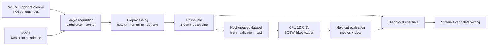

<div align="center">

# Deep Transit

### From Kepler photometry to candidate classification

An end-to-end, CPU-friendly workflow for retrieving real Kepler photometry, processing known KOI transits, preparing a traceable dataset, and scoring candidates with a 1D CNN.

<a href="#quick-start"><strong>Quick start</strong></a> ·
<a href="#workflow"><strong>Workflow</strong></a> ·
<a href="#run-the-app"><strong>Launch the app</strong></a> ·
<a href="#science-notes"><strong>Science notes</strong></a>

<br>


</div>

<details>
<summary><strong>Contents</strong></summary>

- [Quick start](#quick-start)
- [Workflow](#workflow)
- [Run the app](#run-the-app)
- [Project map](#project-map)
- [Science notes](#science-notes)
- [Training and evaluation](#training-and-evaluation)
- [Tests](#tests)
- [Troubleshooting](#troubleshooting)

</details>

## Quick start

### 1. Create an environment

Python 3.10 or newer is required. The project runs on CPU; no GPU is required.

```bash
python -m venv .venv
source .venv/bin/activate            # Windows: .venv\Scripts\activate
python -m pip install -r requirements.txt
```

### 2. Inspect a real Kepler target

```bash
python cli.py inspect --target KOI-1.01 \
  --output data/figures/koi-1.01-stages.png
```

This retrieves catalog metadata and Kepler long-cadence photometry, then saves a six-panel view of the real target through preprocessing. The first uncached request needs internet access to NASA's Exoplanet Archive and MAST. Subsequent requests reuse local caches.

### 3. Prepare examples

Start small to check your environment and data access:

```bash
python cli.py prepare-dataset --limit 10
```

Omit `--limit` to process the full labeled DR25 KOI table. Preparation is resumable; results and exclusions are recorded in `data/metadata/dataset_manifest.csv`.

## Workflow



| Stage | What it does | Main output |
|---|---|---|
| Acquire | Resolves KOI/KIC identifiers, retrieves KOI metadata and Kepler long-cadence light curves, and caches downloads. | FITS light curves and a catalog snapshot |
| Process | Applies the hard quality mask, relative-flux normalization, transit-masked running-median detrending, and epoch-centered phase folding. | Inspectable stages and a `(1, 1000)` vector |
| Prepare | Labels confirmed/candidate KOIs as positive and false positives as negative; groups splits by host star. | NPZ examples and a CSV manifest |
| Train | Fits the specified 1D CNN on CPU with inverse-frequency weighting and validation-based early stopping. | Best checkpoint and training history |
| Evaluate | Reports accuracy, precision, recall, F1, ROC-AUC, and confusion matrix on the held-out test split. | JSON metrics and plots |
| Vet | Searches a target, visualizes its light curve, and compares its score with an adjustable threshold. | Planetary-like and false-positive-like scores |

## Run the app

```bash
streamlit run app/dashboard.py
```

The app has three views:

- **Dashboard** — labeled sample counts, checkpoint status, and the latest held-out evaluation metrics.
- **Target Search** — look up a KOI or KIC and retrieve its available observations.
- **Light Curve Analysis** — inspect each processing step and adjust the classification threshold after training.

The UI separates the catalog disposition from the model output. A model score describes resemblance to labeled examples; it is not evidence that a planet exists.

## Project map

```text
app/                  Streamlit dashboard and target workflow
models/               CNN, inference, and local checkpoints
preprocessing/        Kepler acquisition and transit processing
training/              Dataset builder, PyTorch dataset, train/evaluate
visualization/         Light-curve figures
tests/                 Preprocessing, model, and split checks
data/                  Local cache, examples, metadata, and metrics
config.yaml            Paths and processing/training defaults
```

## Science notes

<details>
<summary><strong>Preprocessing choices</strong></summary>

- **Normalization:** `F / median(F_valid) - 1` using quality-approved finite observations.
- **Quality:** Lightkurve's Kepler hard bitmask. Missing quality flags are an explicit preprocessing error.
- **Detrending:** centered running median over three transit durations by default. The transit plus a configurable margin is masked while estimating the trend; the estimated baseline is interpolated through masked points.
- **Phase:** the supplied transit epoch is centered at phase zero on `[-0.5, 0.5)`. The common modulo expression places the epoch at `-0.5`; this representation rotates the wrapped phase by half an orbit.
- **Resampling:** 1,000 uniform bins with median aggregation. Empty bins are cyclically interpolated for model input, while occupancy is retained so sparse coverage remains visible.
- **Standardization:** the binned vector is scaled to zero mean and unit variance. Constant or invalid vectors are rejected.

</details>

<details>
<summary><strong>Labeling, splits, and thresholds</strong></summary>

- `CONFIRMED` and `CANDIDATE` map to label `1`; `FALSE POSITIVE` maps to label `0`; other dispositions are excluded.
- The host KIC is the split group. A host cannot occur in more than one partition.
- Class weights are computed from training labels only.
- Early stopping uses validation loss. The held-out test split is used only for reported evaluation.
- Threshold changes alter the displayed prediction. They do not alter the underlying probability score.

</details>

## Training and evaluation

After dataset preparation:

```bash
python -m training.train
```

Defaults: 50 epochs, batch size 32, Adam learning rate `0.0001`, weight decay `0.00001`, dropout `0.4`, and patience 8. Configure them in `config.yaml`.

| Artifact | Default location |
|---|---|
| Best checkpoint | `models/checkpoints/deep_transit.pt` |
| Test metrics | `data/metrics/evaluation.json` |
| Loss history | `data/metrics/training_history.json` |
| Evaluation plots | `data/metrics/*.png` |

The full catalog can take considerable time and disk space to download and process. A small `--limit` run checks the pipeline but may not produce all classes in every split and is not suitable for performance claims.

## Tests

```bash
python -m unittest discover -v
```

Preprocessing and host-grouping tests use small component fixtures. CNN tests validate the model's required input and output shapes. No synthetic data is used to train the model.

## Troubleshooting

<details>
<summary><strong>“No complete KOI ephemeris”</strong></summary>

The classifier requires catalog period, epoch, and duration. A target without these values can be displayed as raw photometry, but a separate transit-search step is needed before classification. Deep Transit does not invent an ephemeris.

</details>

<details>
<summary><strong>Training stops because a split is empty or lacks a class</strong></summary>

Use more labeled targets. Host-grouped splitting prevents candidates around the same star from leaking across partitions, so a very small sample may not populate all partitions with both classes.

</details>

<details>
<summary><strong>Data download fails</strong></summary>

Check network access to MAST and the NASA Exoplanet Archive, then retry. Successful FITS downloads and catalog metadata are cached under `data/`.

</details>

## Scientific limits

Deep Transit is a KOI-ephemeris-based candidate-vetting demonstration, not a blind transit search or an independent confirmation system. No research-paper accuracy is claimed. Interpret metrics only with their split manifest, sample counts, and data coverage.
